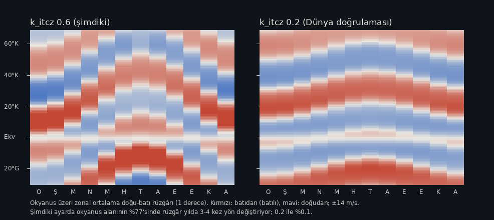
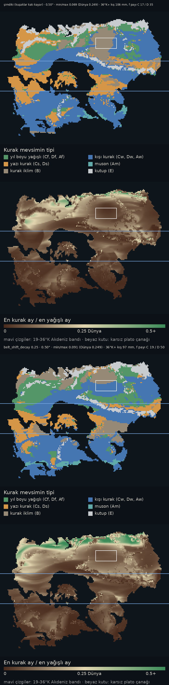

# Gece bakımı günlüğü (gece dalı)

Dünyanın sahibi uyurken yapılan denetim (25-26 Eylül). Kurallar: düzeltmeler
bu dalda, `main`'e girmez (her push telefona yayın); iklim sonucunu
değiştiren şeyler yalnız ölçülür ve buraya yazılır, uygulanmaz. Her kalem:
bulgu, nasıl bulundu, ne yapıldı, nasıl doğrulandı. Uygulama testi her
adımda koştu (şimdi 21 denetim, hepsi geçiyor; GitHub'da da yeşil).

## Özet

49 düzeltme, hepsi `gece` dalında; test her adımda yeşil. En önemlileri:

- **Telefonda hiç çalışmayan özellik:** ay şeridinde parmağı kaydırarak ay
  tarama (36).
- **Yan çevrilmiş telefonda harita ~100 px'e iniyordu;** dok ve ayarlar
  artık sağ sütunda (47).
- **Güvenlik:** tunel.bat açıkken `.git`, `motor/`, `dunya/` internetten
  indirilebiliyordu; baslat.bat yerel ağa açıktı (41).
- **Güncelleme akışı:** elle güncellemede bildirim yoktu (30), yerel kayıt
  engelliyse yeni veri "Güncel" sayılıyordu (44), oturum dolması "sunucuya
  ulaşılamadı" görünüyordu (43). Akış artık testte (45).
- **Ölçüm güvenliği:** yanlış yazılmış parametre adı sessizce taban koşusu
  ölçtürüyordu (42); motorda Dünya yılı sabitti (48, Dünyam'da etkisiz).

Telefonda bakman gerekenler: ay taraması (36), yan çevirme (47), Dolaşım'da
kaydırma akıcılığı (16), çok yakınken kaydırma sınırı (1), geri tuşu (19),
Kar sekmesi ve kart (11, 18), deniz kartı (15, 34), bantlı renk lejantı (27),
iPhone'da çift dokunma (37).

Bilgisayarda: baslat.bat ve tunel.bat bir kez açılmalı (41; Windows'ta
sınanamadı), klavye (22).

Karar bekleyenler: "Yalnız raporlanan" bölümü (en önemlisi: rüzgâr kuşakları
yılda 3-4 kez yön değiştiriyor, görselli; akıntı km/derece sabiti,
klimagram yuvarlaması, küresel ortalama 15.1 °C, artık dallar).

Veri: GitHub gece dalında yeniden üretti (surum 3285f63f32); yalnız rapor metni, damga ve
yarıçap alanı farklı, iklim sayıları birebir aynı ("Temiz çıkan" bölümünde
alan alan karşılaştırma). `main`'e almak için `gece` dalını birleştirmek
yeter (ileri sarma).

## Düzeltilenler

1. **Yakınken harita boşluğa kayabiliyordu.** `sinirla` pan sınırını bütün
   veri kutusuna göre koyuyordu; veride karanın çevresinde 22° okyanus payı
   olduğu için çok yakınken ekran tamamen boş okyanusa ya da verinin dışına
   kayabiliyordu (keşif betiği: tuvalde 2 renk, ekran görüntüsünde boş
   ekran). Artık dikeyde ekranın ortası kara kutusundan, yatayda o satırdaki
   karanın batı/doğu ucundan en fazla görünen alanın %35'i kadar dışarı
   çıkabiliyor. İlk sürüm yalnız dikdörtgen kutuya bağlıydı; yeni test
   kutunun köşesinin açık deniz olduğunu yakaladı, satır satır sınıra
   geçildi. Doğrulama: çok yakınken altı yöne aşırı sürüklemede ekranda
   hep kara var (%20 ile %100); kıyıdaki en güney hücreye iki yakınlıkta
   dokununca hücre kartın üstünde kalıyor.
2. **İlk açılışta sayfa iki kez yükleniyordu.** Service worker ilk kez
   kontrolü alınca `controllerchange` ateşleniyor; olay anında `controller`
   dolu olduğu için kod bunu güncelleme sanıp sayfayı yeniliyordu. Artık
   yalnız açılışta zaten bir service worker varsa yeniliyor. Doğrulama:
   Playwright'ta açılıştan sonraki `evaluate` "context destroyed" hatası
   vermiyor.
3. **Açılışta veri hazırlığı yavaştı.** CPU 4 kat yavaşlatılmış (orta sınıf
   telefon yaklaşığı) ölçümde `veriHazirla` 989 ms sürüyordu. İki sebep:
   - Kar alanı açılışta hesaplanıyordu (~360 ms), ilk ekran kar göstermediği
     halde. Artık ilk kareden sonra boşta hesaplanıyor; Kar sekmesi ya da
     kart daha önce isterse o an (`karAl`).
   - Yüzdelik renk ölçeği için ~650 bin değer sıralanıyordu. Değerler bayt
     kodlarından geldiği için (kodlama başına en fazla 256 değer) havuz
     artık kodlardan sayılarak kuruluyor.

   Sonuç: `veriHazirla` 989 → 239 ms.
   Yan düzeltme: eski havuz Float32'ye yuvarlanmış değer tutup tam hassas
   değerle sorgulandığı için eşit değerler "ortadan" değil bir yandan
   sayılabiliyordu. Renk tablosu farkı en fazla 6/255 (görünmez); lejant
   etiketleri birebir aynı; yalnız bantlı yıllık yağışta bant sınırındaki
   3 kod komşu banda geçti. Test 12/12.
4. **Test bu gecenin düzeltmelerini kapsamıyordu.** Üç denetim eklendi:
   ilk açılışta tek yükleme, kar katmanının çizilmesi (tuval tek renk
   değil, lejant doğru), çok yakınken aşırı sürüklemede karanın ekranda
   kalması. Test 15/15.
5. **Karar notlarında okuma tuzağı.** `_su_butcesi` notunun başı "DEGISIKLIKLER:
   evap_max_mm_month=106" diye başlıyordu; sonradan kaldırılan tavan şu anki
   ayar gibi okunuyordu. "İLK DENEME (sonra değişti)" olarak düzeltildi.
   Eski notlardaki "NIHAI" sınıf payları (örn. `_akdeniz` Cs %10.8) kendi
   tarihlerinin ölçümü; bugün Cs %14.9. Tek yerde güncel durum için
   `_guncel_durum` notu eklendi (veri sürümü 65cf9d017d'nin ölçümleri).
6. **Belgelerdeki koşu süreleri eskimişti.** Nem korunumu motoru yavaşlattı:
   0.25° bu makinede ~14 → ~35 dk, GitHub'da ~12 → ~20 dk (ölçüldü).
   CLAUDE.md ve README güncellendi. Test satırı da yeni denetimleri anıyor.
7. **Dar ekranda lejant etiketleri üst üste biniyordu.** 360 px'te yıllık
   yağışta "1.164" ile "5.610 mm/yıl" birleşip "1.1645.610" okunuyordu
   (yüzdelik ölçekte değerler uçta birbirine yakın). Artık komşusuyla
   çakışan ara etiket gizleniyor, uçlar hep görünüyor; ekran dönünce yeniden
   hesaplanıyor. Doğrulama: 320/360/390/1024 px × 5 katman × 2 dönem,
   çakışma ve taşma yok.
8. **Ayar çekmecesi açıkken hücre kartı haritayı örtüyordu.** Çekmece yarıda
   durur ki ayar değişikliği haritada görülsün; kart tam o alanı kapatıyordu.
   Çekmece açıkken kart gizleniyor (kapanmıyor), çekmece kapanınca geri
   geliyor. Doğrulama: 360×640'ta aç/kapa.
9. **Hareketli rüzgâr yüksek yenileme hızlı ekranda hızlı akıyordu.**
   Parçacık hızı ve iz sönümü kare başına tanımlıydı; 90/120 Hz ekranda
   parçacıklar 1.5-2 kat hızlı akıp izleri kısalıyordu. Adım artık geçen
   süreyle ölçekleniyor (60 Hz'de davranış aynı), arka plandan dönüşte
   sıçrama olmasın diye en fazla 3 kare. Test 15/15.
10. **`_senkron_kontrol.py` yanlış yolda anlaşılmaz çıktı veriyordu.** Proje
    yolu yoksa ya da yanlışsa her dosya için ayrı "projede yok" yazıyordu.
    Artık yol kontrol ediliyor (`climate/` var mı) ve tek satırlık açık hata
    ile 2 kodu dönüyor.
11. **Buzul hücrelerinde kar kalınlığı anlamsızdı.** 1076 kara hücresinde
    yıllık kar yağışı yıllık erime kapasitesini aşıyor, kar hiç erimeden
    birikiyor. Kart burada "en kalın ..., X mm su" yazıyordu ama X yalnız kar
    hesabının kaç yıl döndürüldüğüne bağlı. Artık bu hücreler "kalıcı,
    erimiyor (buzul)" gösteriyor. Kontrol: 784'ü EF (buz örtüsü), 289'u ET,
    3'ü BSk; tutarlı. Test 15/15.
12. **GitHub testi yayınlanan dosyaları değil repo kökünü test ediyordu.**
    Cloudflare yalnız `yayinla.sh`'nin `site/`'ye kopyaladıklarını yayınlıyor;
    oraya eklenmesi unutulan bir dosya telefonda eksik kalır ama kökte test
    geçerdi. `uygulama.yml` ve `veri.yml` artık `sh yayinla.sh && node
    test/uygulama_test.js site` koşuyor; `yayinla.sh` değişince de test
    tetikleniyor. `yayinla.sh` yorumu "Pages" yerine Workers'ı anlatıyor.
    Doğrulama: yerelde `site/` üzerinde 15/15.
13. **README eksikleri.** Dosya tablosuna `mevsim_olc.py` eklendi; test
    satırı `site/` kümesini anıyor; dal önizlemesinin adres biçimi,
    `"previews": {}` gereği ve Access uyarısı yazıldı.
14. **Dolaşım sekmesinde deniz sıcaklığı alanı dikdörtgen kenarla
    kesiliyordu** (veri karanın ~22° ötesinde biter). Son %4'te koyu zemine
    yumuşak geçiş eklendi; diğer katmanlarda uzak okyanus zaten zemine
    karışıyordu. Test 15/15.
15. **Metin düzeltmeleri.** Deniz kartı her okyanus hücresine "Açık deniz"
    yazıyordu (kıyı suları ve iç deniz dahil); artık "Deniz" ve en yakın
    kıyıya yaklaşık uzaklık ("kıyıya ~250 km", 30 km altı "kıyıya yakın").
    Yükleme hatası "İlk kurulum için sunucu açık olmalı" diyordu (eski tünel
    dönemi); artık "İlk açılış için internet bağlantısı gerekli".
16. **Dolaşım sekmesinde kaydırma takılıyordu.** 40 adımlık sürükleme
    (CPU 4 kat yavaş) İklim'de 3.8 s, Dolaşım'da 18.9 s sürdü. Profil: JS
    değil, büyük SVG kaplamasının her karede yeniden kurulup boyanması
    (kaplama gizlenince 3.7 s). Artık hareket sürerken son çizim CSS
    dönüşümüyle kaydırılıp ölçekleniyor, parmak kalkınca / tekerlek durunca
    bir kez yeniden kuruluyor (sayıldı: sürüklemede 0 yeniden kurma, 20
    dönüşüm; bırakınca 1 kurma). Dürüst not: bu test ortamı GPU'yu yazılımla
    taklit ediyor ve orada kazanç yalnız %22 (9.2 → 7.1 s); gerçek telefon
    GPU'sunda katman kaydırmak çok daha ucuz olmalı ama buradan ölçemedim.
    Telefonda Dolaşım'da kaydırmanın akıcılığına bakman gerekiyor. Test 15/15.
17. **CLAUDE.md'ye tuzak eklendi (§7.7):** bulut makinesinde çizim
    performansı yanıltır (yazılım GPU); JS maliyeti CPU ×4 ile ve profille
    ölçülür, çizim telefonda doğrulanır.
18. **Kar örtüsü süresi fazla hesaplanıyordu.** Eşikleri Dünya istasyonlarıyla
    kaba sınadım (Moskova ve Ulan Batur aylık normalleri, uygulamanın kendi
    `karHesapla`'sı). Moskova 6 ay örtü veriyordu (gerçekte kabaca Kasım
    sonu–Nisan başı, ~4.5 ay); Nisan ortasında 109 mm su görünüyordu. Sebep
    tanım: "ay ortası" ayın başı ile sonunun ortalamasıydı; kar ayın başında
    eriyip bitse de başlangıç büyükse ay örtülü sayılıyordu. Artık ay içi
    yağış ve erime doğrusal kabul edilip ayın ortasındaki durum hesaplanıyor.
    Moskova 5 ay (Kas–Mar), Ulan Batur 4 ay ince örtü. Dünyam: örtülü kara
    payı aynı (%41.9), ortalama örtü süresi 2.55 → 2.23 ay. Test 15/15.
    CLAUDE.md §1'deki kar tanımı güncellendi.
19. **Android geri tuşu uygulamadan çıkıyordu.** Kart, ayar çekmecesi ya da
    sınıf listesi açıkken geri tuşu bunları kapatmıyor, doğrudan uygulamadan
    çıkıyordu (kodda geçmiş yönetimi yoktu). Artık biri açılınca geçmişe tek
    durum itiliyor, geri tuşu açık olanları kapatıyor; arayüzden (X,
    sürükleme) kapatılınca itilen durum geri alınıyor, geçmiş şişmiyor.
    Doğrulama: kart / çekmece / sınıf listesi / kart+çekmece senaryolarında
    geri sonrası hepsi kapalı, sayfa aynı, geçmiş uzunluğu sabit. Teste
    denetim eklendi, 16/16.
20. **Yatay iPhone'da çentik başlığı ve sekmeleri örtebiliyordu.** Sayfa
    viewport-fit=cover kullanıyor; üst ve alt güvenli alan payı vardı, sol
    ve sağ yoktu. Başlık, alt dok, kart ve ayar çekmecesine safe-area-inset-
    left/right payları eklendi. Doğrulama: 844×390'da 47 px çentik
    taklidiyle başlık, menü düğmesi, ilk/son sekme ve lejant çentiğin
    dışında. Test 16/16.
21. **Veri üretimi yavaştı (35 dk); sonucu değiştirmeden 16 dk'ya indi.**
    Nem çözücüsü 12 ayı sırayla çözüyordu, oysa aylar birbirinden bağımsız.
    Artık fork ile paralel (4 çekirdek); fork yoksa (Windows) ya da
    DUNYAM_ISCI=1 ile sıralı. Doğrulama: 1°'de yağış, buhar, sınıf ve
    sıcaklık dizileri sıralı koşuyla birebir eşit; 0.25°'de tam üretimin
    içerik özeti yayındaki veriyle aynı (65cf9d017d); GitHub'da da aynı
    özet, veri commit'i yok. Süre: bu makinede 35 → 15.7 dk, GitHub'da 19.4
    → 11.6 dk. Motor değişikliği olduğu için Proje 3 ayrışma listesine
    eklendi (CLAUDE.md §7.6). Yan düzeltme: uret.py --cikti klasör verilince
    hesap bittikten sonra yazarken düşüyordu; artık klasörü kabul ediyor.
22. **Bilgisayarda klavye hiç çalışmıyordu** (baslat.bat ile masaüstü
    kullanımı). Eklendi: Esc açık çekmece/sayfayı, yoksa kartı kapatır;
    oklar kaydırır; +/− yakınlaştırır; 0 kıtaya sığdırır. Doğrulama:
    1280×800'de hepsi denendi, JS hatası yok. Test 16/16.
23. **baslat.bat tarayıcıyı sunucudan önce açıyordu;** ilk açılışta
    'bağlanılamadı' sayfası görünebiliyordu. Artık önce sunucu ayrı
    pencerede başlıyor, 2 saniye sonra tarayıcı açılıyor. (Windows'ta
    denenemedi; komutlar standart cmd.)
24. **Kendi kodumda hata (madde 1'in devamı):** satır sınırındaki geri
    doldurma, karanın olmadığı en üst satırlara en üstteki karalı satırın
    değil en alt satırın batı/doğu uçlarını kopyalıyordu. Kod gözden
    geçirmede bulundu, düzeltildi; en üst satır artık ilk karalı satırın
    uçlarını alıyor (doğrulandı: 0. satır = 83. satır = [318, 377]). Test
    16/16.
25. **'Güncellemeleri denetle' internetsizken 'Güncel' diyordu.** Service
    worker bağlantı yoksa sessizce önbellekteki veriyi veriyor, düğme de onu
    sunucudaki sanıyordu; yeni veri çıkmış olsa bile kullanıcı güncel
    olduğunu düşünürdü. Düğmenin isteği artık X-Taze işareti taşıyor,
    service worker bu istekte önbelleğe düşmüyor; güncelleme denetimi de
    beklenmiyor (çevrimdışı asılı kalabiliyordu), 'Denetleniyor…' hemen
    görünüyor. Doğrulama: eski kod çevrimdışı ['Güncel · veri 65cf9d017d'],
    yeni kod ['Denetleniyor…', 'Sunucuya ulaşılamadı, önbellekteki sürüm
    açık']; çevrimdışı açılış testi geçiyor. Not: sw.js değiştiği için
    telefonda ilk açılışta sayfa bir kez yenilenir (beklenen).
26. **'İnternetsiz açılıyor' testi ağ açıkken geçiyordu.** Playwright'ın
    çevrimdışı taklidi yeniden başlayan service worker'a uygulanmıyor: sayfa
    çevrimdışı yeniden yüklendikten sonra service worker sunucuya ulaştı
    (var olmayan dosyaya 404). Yani test çevrimdışı çalışmayı hiç
    sınamıyordu. Artık test sırasında sunucu da kapatılıyor (gerçek kesinti)
    ve ağın gerçekten kapalı olduğu kontrol ediliyor. Uygulama bu gerçek
    kesintide de önbellekten açılıyor. Aynı kesintiye 'Güncellemeleri
    denetle' denetimi eklendi (madde 25). Test 17/17.
27. **Bantlı lejant ve kabartma seçimi.** Bantlı renk açıkken lejant
    etiketleri çeyrekliklerde duruyordu (%25, %50, %75), bantlar ise altıda
    bir sınırlarında; etiketler bantların ortasına düşüyor, hangi değerin
    bandı böldüğü okunmuyordu. Bantlıyken etiketler artık 7 bant sınırında
    (çakışan ara etiket gizlenir). Ayrıca kabartma gölgesi kapalıyken kaynak
    seçimi (Birleşik/Editör/Yükseklik) hâlâ etkin görünüyordu; şimdi soluk
    ve dokunulmaz.
28. **Ondalık ayırıcı.** Ondalık ayırıcı karışıktı: lejant ve deniz kartı
    virgül (17,6), sınıf payları, koordinatlar, künye ve iç tutarlılık
    metinleri nokta (%11.5, 41.2°K, 0.26°) yazıyordu. Hepsi Türkçe virgüle
    çekildi; tutarlılık metinlerindeki eksi işareti tipografik eksi oldu
    (tire içeren sözcüklere dokunmadan).
29. **Donmuş okyanus metni eskimişti.** İç tutarlılık raporu donmuş okyanus
    satırında 'buz yüzeyi ve buz-albedo modelde yok' diyordu; sea_ice_air
    açık olduğundan buz üstü havası artık var. Metin anahtara bağlandı:
    açıkken 'buz üstü havası kıyıya taşınıyor, buz-albedo modelde yok'.
    Yalnız metin; sayılar değişmez ama surum değişeceği için veri iş akışı
    gece dalında veriyi yeniden üretecek (1 derecede doğrulandı, 12/12).
30. **Elle güncellemede bildirim yoktu; zaman damgası.** 'Güncellemeleri
    denetle' yeni veri bulunca sürümü yerel kayda yazıp sayfayı yeniliyordu;
    açılış farkı göremediği için 'Yeni veri yüklendi' bildirimi hiç
    çıkmıyor, sayfa sessizce yenileniyordu. Kayıt artık açılışa bırakıldı
    (tarayıcıda doğrulandı: bildirim çıkıyor). Üretim damgası makinenin
    yerel saatiydi (GitHub'da UTC, masaüstünde TSİ, ayırt edilemiyordu):
    artık UTC yazılıyor, uygulama telefonun saatine çevirip '25 Eylül 2026
    22:29' biçiminde gösteriyor; eski biçim olduğu gibi. Veri satırındaki
    'editor gorseli' Türkçe harflerle.
31. **Kar testi rastgeleydi.** Testin kar katmanı denetimi tuvalden rastgele
    80 nokta okuyordu; sonuç koşudan koşuya değişebilirdi. Sabit 10×8
    ızgaraya çevrildi (44 farklı renk, eşik 5).
32. **Yakınken enlem etiketi yoktu.** Enlem etiketleri yalnız 60/30/0/−30'da
    yazılıyordu; yakınlaşınca ızgara 10° aralığa geçiyor ama etiket
    kalmıyordu (30'un katları ekrandan çıkınca hiç enlem yazmıyordu). Etiket
    adımı artık çizgiyle aynı: uzakta 30°, yakında 10°.
33. **Belgede eski sayılar.** CLAUDE.md eski sayılar taşıyordu: kara payı
    %6.8 alan / %5.3 hücre (0.25 derecede yeniden ölçüldü: %6.95 / %5.40;
    uygulama künyesi %6.9 diyor), kara min/max ay oranı 0.078 (güncel veri
    0.076). Düzeltildi.
34. **Deniz kartında ay adı.** Deniz kartında en sıcak/en soğuk ay
    değerlerinin altında yalnız 'en sıcak ay' yazıyordu, hangi ay olduğu
    yoktu; kara kartındaki gibi ayın adı yazılıyor (ör. AĞUSTOS, OCAK).
35. **Canvas2D yedeği testte yoktu.** Canvas2D yedek çizimi (telefonda WebGL
    reddedilirse tek yol) CI'da hiç sınanmıyordu, yalnız bir kez elle
    denetlenmişti. Teste eklendi: WebGL bağlamı engellenmiş ikinci sayfa
    açılıyor, 2D tuvalde en az 6 farklı renk ve sayfa hatası yok bekleniyor.
    Yedeği bilerek bozunca denetim düşüyor (doğrulandı). 18/18.
36. **Ay şeridinde parmakla tarama telefonda hiç çalışmıyordu.** Şeritte
    parmağı kaydırarak ayları tarama kodu var, ama şeritte touch-action
    tanımlı değildi: tarayıcı hareketi sayfa kaydırması sayıp ikinci adımda
    pointercancel gönderiyor, ay ilk dokunulanda kalıyordu. CDP dokunma
    olaylarıyla ölçüldü: Şubat'tan Kasım'a 20 adımlık kaydırmada 2 hareket,
    1 iptal, ay Şubat'ta kaldı. #donem'e touch-action:none: 20 hareket, 0
    iptal, ay Kasım. Teste eklendi; düzeltme kaldırılınca denetim düşüyor
    (doğrulandı). 19/19.
37. **Düğmelerde çift dokunma yakınlaştırması.** Sayfa geneline touch-
    action:manipulation eklendi (harita none olarak kalır). iOS Safari ay
    şeridinde hızlı iki dokunuşu sayfa yakınlaştırması sayabiliyor;
    manipulation bunu keser, kaydırma ve sıkıştırmaya dokunmaz.
    DOĞRULANAMADI: headless Chromium'da sayfa yakınlaştırması kapalı;
    standart önlem, iPhone'da bakılmalı. Testler 19/19, ay taraması
    etkilenmedi.
38. **Canvas2D yedeğinde sınıf yalıtma yoktu.** Sınıf listesinden bir sınıfa
    dokununca WebGL'de yalnız o sınıf renkli kalıyor, yedek çizimde bütün
    sınıflar olduğu gibi görünüyordu ve 'Hepsi' yedeği yeniden boyamıyordu.
    Yedek artık shader'la aynı karartmayı uyguluyor. Doğrulama: WebGL
    engellenmiş sayfada Cwa yalıtılınca yalnız Cwa yeşil, gerisi gri (ekran
    görüntüsü); 'Hepsi' ile 21 renge geri dönüyor.
39. **Fare tekerleği Firefox'ta neredeyse yakınlaştırmıyordu.** Tekerlek
    olayının deltaMode'u hesaba katılmıyordu; satır kipinde (Firefox, deltaY
    ≈ 3) tık başına ~%0.5 yakınlaşma. Satır 16 px, sayfa 400 px sayılıyor.
    Chromium'da değişiklik yok (piksel kipi); Firefox bu makinede yok,
    formülle doğrulandı.
40. **Simge değişikliği testi tetiklemiyordu.** uygulama.yml'nin yol
    listesinde icons/ yoktu; simgeler yayınlanan kümede (yayinla.sh) olduğu
    halde değişince test koşmuyordu. Eklendi.
41. **Tünel ve yerel sunucu depo kökünü açıyordu.** tunel.bat python
    http.server'ı depo kökünde başlatıyordu: tünel adresi açıkken .git
    (bütün geçmiş), motor/, dunya/ internetten indirilebiliyordu; yayinla.sh
    bunları bilerek yayından hariç tutuyor. tunel.bat artık yayinla.sh'deki
    dosyaları site/'ye kopyalayıp yalnız onu sunuyor (listelerin aynı
    kalması iki dosyada ve CLAUDE.md'de not edildi). baslat.bat sunucuyu
    0.0.0.0'da açıyordu (yerel ağdaki her cihaz depo kökünü görebiliyordu);
    127.0.0.1'e bağlandı, adres aynı (localhost). DOĞRULANAMADI: Windows
    yok; --bind ve --directory bayrakları burada Python ile denendi, toplu
    iş sözdizimi elle okundu. Tünel artık yedek yol olduğundan etkisi
    sınırlı.
42. **Yanlış yazılmış parametre adı sessizce yutuluyordu.** mevsim_olc.py
    --p convective_C=0.3 (büyük C) hatasız koşup taban dünyayı ölçüyordu:
    deneme 'etkisiz' diye yanlış okunurdu. --p foo ise Python izi basıyordu.
    dunyam.json params'ında da aynı risk (motor bilinmeyen anahtarı okumaz).
    uret.py'ye bilinmeyen_params eklendi: katmanların DEFAULTS'u ve motorda
    params.get/params[] ile okunan adlar (76 ad) dışındaki her anahtar yazım
    hatası sayılır; uret.py durur (--zorla ile geçilir), mevsim_olc.py
    durur. Bugünkü dunyam.json'da bilinmeyen ad yok (1 derecelik koşu
    12/12). kabartma_kaydet.py yanlış yolda iz yerine 'gorsel bulunamadi'
    diyor. heightmap anahtarları da denetleniyor (elev_curv gibi bir hata
    eğriyi sessizce kapatırdı). Yapay yazım hatasıyla denendi: "storm_C,
    heightmap.elev_curv" diye durdu.
43. **Güncelleme denetiminde oturum dolması 'sunucuya ulaşılamadı'
    görünüyordu; bildirim taşabiliyordu.** Cloudflare Access oturumu dolunca
    veri isteği giriş sayfasına yönlenir ve CORS'ta düşer; mesaj internet
    yokmuş gibi okunuyordu. Artık çevrimdışıysa 'İnternet yok, önbellekteki
    sürüm açık', çevrimiçiyken istek düşerse 'Oturum dolmuş olabilir:
    uygulamayı kapatıp yeniden aç' (yeniden açınca sayfa isteği giriş
    sayfasına gider, CLAUDE.md §7.5). İki yol da tarayıcıda denendi.
    Bildirim kutusu white-space:nowrap idi; uzun metin 390 px ekrandan
    taşardı. Artık ekran genişliği −32 px'te sarıyor (16..374 px, iki
    satır).
44. **Güncelleme denetimi yerel kayda dayanıyordu.** Yeni veri olup olmadığı
    localStorage'daki sürümle karşılaştırılıyordu; kayıt engelliyse (gizli
    sekme, bazı Safari ayarları) sunucudaki yeni veri 'Güncel' diye
    geçiliyordu. Artık ekranda açık olan verinin sürümüyle
    karşılaştırılıyor. Doğrulama: depolama engelli + sunucuda sürüm
    değiştirilmiş taklitte sayfa yenilendi; normal yol (bildirim) de
    çalışıyor.
45. **Güncelleme akışı testte yoktu.** Bu gece iki kez bozuk çıkan yol
    (madde 30 ve 44): sunucuda yeni veri varken 'Güncellemeleri denetle'
    sayfayı yenilemeli ve 'Yeni veri yüklendi' demeli. Teste eklendi: veri
    isteği yakalanıp sürüm değiştiriliyor, yenileme ve bildirim bekleniyor.
    Madde 30'daki eski hatayı geri koyunca denetim düşüyor (doğrulandı).
    20/20.
46. **Elle veri üretiminde '0,5' düşerdi; girdi kabuğa gömülüyordu.**
    Actions → atlas verisi → Run workflow kutusuna Türkçe alışkanlıkla '0,5'
    yazılırsa uret.py 'invalid float' ile düşerdi. uret.py ve mevsim_olc.py
    artık ondalık virgülü kabul ediyor, sayı değilse Türkçe hata veriyor
    (1,0 ile 1 derecelik koşu 12/12). Ayrıca veri.yml girdiyi ${{ }} ile
    doğrudan run satırına gömüyordu (GitHub'un uyardığı enjeksiyon kalıbı;
    yalnız repoya yazabilen başlatabildiği için risk düşük); artık ortam
    değişkeniyle geçiyor.
47. **Telefon yan çevrilince harita neredeyse kayboluyordu.** 844×390'da alt
    dok ekranın %53'ünü kaplıyor, haritaya ~97 px kalıyordu; Dolaşım'da
    açılan deniz kartı başlığın üstüne binip seçili hücreyi tamamen
    örtüyordu; ayar çekmecesi alttan açılıp haritanın alt yarısını
    kapatıyordu (ekran görüntüleriyle bulundu). Yatay kısa ekranda
    (yükseklik ≤ 500 px) dok artık sağda 340 px'lik sütun, harita solda tam
    yükseklikte; kart haritanın altında, ayar çekmecesi yan sütunun yerine
    açılıyor (harita bütünüyle görünür, sürükleme tutamağı yok, X ile
    kapanır). Görünür alan hesabı tek yerde (gorunen): sığdırma, pan sınırı,
    parçacıklar ve etiketler buna göre. Dikey ekran ve tablet (1024×768)
    değişmedi; 844×390, 667×375, 390×844, 1024×768'de taşan öğe yok;
    döndürmeli rastgele tarama 0 hata; test 20/20, sonra yatay düzen teste eklendi (21/21). Telefonda bakılmalı: yan
    çevirip Dolaşım, kart ve ayarlar.
48. **Motorda Dünya yılı sabitlenmişti (CLAUDE.md §2.1 ihlali).**
    motor/moisture.py ayın saniyesini SECONDS_PER_MONTH = 365.25 × 86400 /
    12 sabitinden alıyordu; gezegenin year_length_days'i kullanılmıyordu.
    Yağış, yakınsama, girdap, orografik yağış ve korunum adımları ayı
    saniyeye bununla çeviriyor; yılı farklı bir dünyada aylık miktarlar yıl
    oranında kayardı (500 günlük yılda ay ~%27 kısa sayılırdı). Artık
    params() gezegenin yılından '_saniye_ay' koyuyor. Dünyam'ın yılı zaten
    365.25 gün (künye yuvarlayıp '365' yazıyor): 1 derecede surum önce ve
    sonra f79c6ff75e, bit bit aynı; veri değişmez. İlk ölçümümde yılı
    yanlışlıkla 365.0 alıp %0.06 sınıf değişimi bulmuştum; o varsayım
    yanlıştı. motor/ ayrışma listesine eklendi, asıl projeye taşınmalı.
49. **Uygulamada Dünya yarıçapı sabitti.** Deniz kartındaki kıyı uzaklığı
    6371 km, Dolaşım'daki akıntı şeridi genişliği 111.2 km/derece ile
    hesaplanıyordu. uret.py artık veriye gezegenin radius_km'ini yazıyor,
    uygulama onu kullanıyor (eski veride yoksa 6371). Dünyam'ın yarıçapı
    6371 olduğu için görünür fark yok (kart aynı: 'kıyıya ~1.950 km'). Veri
    iş akışı yeni alan yüzünden veriyi yeniden üretecek; sayısal alanların
    aynı kaldığı alan alan karşılaştırılacak.
50. **Yatay düzende parçacıkların ~%40'ı görünmeyen yerde doğuyordu.**
    Hareketli rüzgâr parçacıkları tuvalin bütün genişliğinde doğuyordu; yan
    dok gelince (madde 47) sağdaki 340 px'e düşenler boşa çiziliyordu. Artık
    yalnız görünen haritada doğuyorlar, sayı da o genişlikle orantılı. Bildirim kutusu da yatayda harita alanının
    ortasında (16..488 px, dok 504'te başlıyor). Dikey ekranda sayı ve görünüş değişmedi (ilk denemede sayıyı görünen alana
    göre küçültmüştüm, dikeyde parçacık seyrekleşiyordu; geri alındı).
51. **Deniz kartı yıllık rüzgârı yanlış gösteriyordu.** Yıllık görünümde 12
    ayın ortalama vektörünün boyu 'm/s rüzgâr' diye yazılıyor ve yönü
    söyleniyordu. Rüzgâr yıl içinde dönen yerlerde (aşağıda raporlanan kuşak
    davranışı yüzünden okyanusun çoğu) bu ~0 çıkıyordu: 73.5°K 33°B'de '0,7
    m/s, batıdan' yazıyordu, oysa aylık hızların ortalaması 4.1 m/s. Kart
    artık zemin katmanıyla aynı büyüklüğü (aylık hızların ortalaması)
    yazıyor; ortalama vektör bu hızın yarısından küçükse 'rüzgâr yönü
    mevsimle değişiyor' diyor. Aylık görünüm değişmedi. Dolaşım'ın yıllık alt başlığı
    'yıllık ortalama' yerine 'yıllık net rüzgâr': oklar bileşke rüzgârı çiziyor.
52. **Rüzgâr dönüşü ölçü aracında yoktu.** mevsim_olc.py artık
    'ruzgar_donusu' veriyor: yüzey rüzgârının doğu-batı bileşeni yılda en az
    3 kez yön değiştiren okyanus ve kara alan payı (şimdi %76.7 / %66.3,
    önceki ölçümle aynı). Kuşak ya da k_itcz denemelerinde bu bedel artık
    her koşuda görünür.
53. **Kuşak kayması deneme düğmesi (kapalı).** motor/circulation.py'ye
    belt_shift_decay eklendi, varsayılan 0 ile sonuç bit bit aynı (1
    derecede surum c2020f9c7e önce ve sonra). Dünyam'da kapalı; ölçümü ve
    görseli 'Yalnız raporlanan' bölümündeki rüzgâr kuşakları maddesinde.

## Yalnız raporlanan (senin kararın)

- **Motor yavaşlığı** (çözüldü, bkz. madde 21: aylar paralel, sonuç aynı). Tek ayın içinde
  yumuşatmayı yeniden kullanmak ek ~%30 kazandırır ama sonucu çok az değiştirir;
  yapılmadı.
- **Kartta sınıf ile klimagram %2.1 karada çelişiyor.** Kaydedilen Köppen
  sınıfı, uygulamanın gösterdiği aylık değerlerden yeniden hesaplanınca
  karanın %2.1'inde (alan ağırlıklı, 1059 hücre) farklı çıkıyor; en sık
  Cwa/Cwb, Csa/Csb, Dfa/Dfb (hepsi 22 °C sıcak ay eşiği). Sebep: veri
  dosyasında aylık sıcaklık 0.32 °C adımla saklanıyor. Motorun sınıfı
  doğru; eşiğin hemen yanındaki hücrelerde gösterilen değer yuvarlanmış.
  Düzeltme: sıcaklığı 2 baytla saklamak (atlas.json ~0.8 MB büyür).
  Öncelik DÜŞÜK: fark en fazla 0.16 °C, kart sıcaklığı tam dereceye yuvarlıyor;
  gözle görülebilir bir çelişki değil. Açılışı yavaşlatmaya değmez bence.

- **Küresel ortalama sıcaklık hedefin 1.1 °C üstünde.** Dünyanın kimliğinde
  (CLAUDE.md §6) deniz seviyesi ortalaması 14 °C yazıyor; model 15.1 °C
  veriyor (tutarlılık kontrolü ±3 °C toleransla geçiyor). Fark bugünkü
  değişikliklerden değil, 24 Eylül'deki en eski veri sürümlerinden beri
  aynı; akıntı ve denizellik katmanları ortalamayı yukarı itiyor. 14'e
  oturtmak için global_mean_sealevel_temp_c'yi ~12.9'a çekmek gerekir, ama
  bu savan/ılıman dengesini (14 °C'nin seçilme sebebi) değiştirir. Öneri:
  dokunma, yalnız §6'ya 'gerçekleşen 15.1' notu düşülebilir. Not düşüldü
  (yalnız belge); parametre kararı senin.

- **Artık dallar.** arayuz-yeni, yukseklik-kaynak, su-butcesi ve
  claude/repo-access-check-2kwdm0 dallarının main'e girmemiş hiçbir commit'i
  yok (tamamen birleşmiş). Her birinin Cloudflare'de önizleme adresi
  olabilir ve Access ile korunmuyorsa herkese açık. Silinmeleri önerilir;
  silme geri alınamaz olduğu için yapmadım, onayını bekliyor.

- **Akıntı uzaklığında Dünya elipsoidi sabit (CLAUDE.md §2.1).**
  motor/temperature.py _segment_distance_km dereceyi km'ye 111.32 (doğu-
  batı) ve 110.57 (kuzey-güney) ile çeviriyor: bunlar Dünya elipsoidinin
  değerleri; gezegenin radius_km'i kullanılmıyor. Dünyam'ın yarıçapı 6371
  km, küre değeri 111.195 km/derece; akıntı genişlikleri (width_km) bu
  yüzden binde birkaç kaymış. Ölçüldü (0.5 derece, --kiyas, 111.195 ile):
  karanın %0.05'i sınıf değiştiriyor, ana grup %0.01. Düzeltme: radius_km ×
  π/180 (küre). surum değişir, veri yeniden üretilir; etkisi küçük ama sayı
  değiştirdiği için uygulamadım. Yarıçapı farklı bir dünyada (ör. 4000 km)
  uzaklıklar 1.59 kat
  sayılır, akıntılar ~%37 dar kalırdı.

- **Rüzgâr kuşakları yılda 3-4 kez yön değiştiriyor (k_itcz 0.6'nın
  yazılmamış bedeli).** Deniz kartını denetlerken bulundu: okyanus alanının
  %76.7'sinde, karanın %66.3'ünde yüzey rüzgârı yılda en az 3 kez batılıdan
  doğuluya dönüyor (45°K okyanus ortalaması: Oca +8, Mar −5, Nis −8, Haz +8,
  Eki −8 m/s). Mekanizma (motor/circulation.py _belt_nodes): bütün basınç
  kuşakları, kutup yüksekleri dahil, ITCZ ile katı olarak kayıyor. 15
  saatlik günde kuşak aralığı φ_H = 18.8°, ITCZ salınımı k_itcz × eğiklik =
  0.6 × 28° = ±16.8°: her enlem yılda neredeyse bir tam kuşak ileri geri
  geçiyor. k_itcz 0.2 (Dünya doğrulaması) ile oran %0.1 / %0.6. Dünya'da
  orta enlem kuşakları yalnız ~5-10° kayar. Görsel:
  gece_resim/zonal_ruzgar.png (enlem × ay, kırmızı batılı, mavi doğulu).
  Etkisi: denizellik, nem taşınımı ve fırtına terimi bu rüzgârı kullanıyor;
  akıntı yerleşimi de (_akintilar) yıllık ortalama rüzgârdan türetilmişti,
  ki bu dönüşler yüzünden zayıf. Akdeniz kuşağı bu salınımdan geliyor, yani
  bilerek seçilen bir kurgu kararının parçası olabilir; notlarda (_akdeniz)
  yalnız Af kaybı bedel olarak yazılı. Olası kol (ölçülmedi): kuşak
  kaymasını enlemle azaltmak (ITCZ tam kayar, kutba doğru daha az). Bu
  iklimi değiştirir; karar senin, görsel karşılaştırmayla sorarım.

    Ek ölçüm (1 derece, kaba; yalnız k_itcz değişti; 0.6 / 0.4 / 0.2):
  rüzgâr dönen okyanus %77 / %20 / %0.1; kara min/max ay oranı 0.065 / 0.089
  / 0.138 (Dünya 0.249); Akdeniz bandında Cs %47 / %35 / %7; plato bozkırı
  %70 / %28 / %39; B grubu %8.7 / %12.7 / %22.4. Yani CLAUDE.md §8'deki
  'yağış çok mevsimsel' sorununun önemli bir kaynağı bu salınım, ama Akdeniz
  kuşağı ve plato bozkırı da ondan geliyor: salınımı azaltmak ikisini de
  bozuyor. Tek düğmeyle çözülmez; enlemle azalan kayma ayrı bir motor kolu
  olur (ölçülmedi).

  

    Kolu ölçülebilir kıldım: motor/circulation.py'ye belt_shift_decay
  eklendi (ITCZ'den k. kuşak ITCZ kaymasının max(0, 1 − k·d) kadarını izler;
  varsayılan 0 = kapalı, 1 derecede surum c2020f9c7e önce/sonra aynı).
  Dünyam'a UYGULANMADI. 1 derece ölçüm (d = 0.25 / 0.4 / 0.5): dönen okyanus
  %20 / %14 / %11; min/max 0.087 / 0.109 / 0.126; Akdeniz bandında Cs %37 /
  %20 / %11; plato bozkırı %16 / %50 / %74; sınıfı değişen kara %38 / %49 /
  %55 (en büyük geçiş Csa → BSh %3.3-3.9). Yani dünyayı baştan değiştiriyor,
  kolay kazanç değil. Görsel (0.5 derece, üstte şimdiki, altta d = 0.25):
  gece_resim/kusak_kaymasi.png. İstersen sabah birlikte bakarız; istemezsen
  parametre kapalı kalır, hiçbir şeyi etkilemez.

  

## Temiz çıkan denetimler (sorun bulunmadı)

- Rastgele etkileşim taraması: 3 tohum, 1100 eylem (dokunma, çift dokunma,
  sekme/ay, çekmece, anahtarlar, sınıf izolasyonu, döndürme, yakınlaştırma,
  sürükleme): 0 JS hatası.
- WebGL'siz yedek çizim (Canvas2D): 6 sekme hatasız.
- 360×640 ve 1024×768'de taşan öğe yok.
- `index.html` ve `manifest.webmanifest`: eksik yok.
- Python dosyalarında statik tarama (pyflakes): temiz.
- `yayinla.sh` 17 dosya kopyalıyor, eksik yok; `site/` git'te izlenmiyor.
- Tutarlılık kontrolü metinleri güncel veriyle uyumlu (12/12). Sonradan
  biri eskimiş çıktı: donmuş okyanus satırı, madde 29.
- Ham yağış alanında 57-59°K satır sıçraması: kıyı geçişinden, artefakt değil.
- Yeniden keşif taraması (bütün değişikliklerden sonra): 6 sekme × 13 dönem × rastgele dokunma, döndürme, aşırı yakınlaştırma: JS hatası yok, boş ekran bulgusu artık çıkmıyor; açılış 934 ms (yavaşlatmasız). Kalan tek uyarı 'NaN/sonsuz yok' tutarlılık kontrolünün adı (yanlış alarm).
- Safari uyumu (statik tarama): yeni API yok; yalnız :has() (Safari 15.4+), daha eskide yalnız 'çekmece açıkken kart gizli' çalışmaz.
- WebGL bağlam kaybı taklidi (Android arka plan): kayıp sırasında sekme/yakınlaştırma hatasız; bağlam dönünce sayfa bir kez yeniden yükleniyor ve WebGL'le açılıyor.
- Kod gözden geçirme (bu gecenin bütün app.js farkı): bir hata bulundu ve düzeltildi (madde 24); yüzdelik/kantil ikili aramaları, geri tuşu, kaplama dönüşümü, klavye doğru.
- Rastgele etkileşim taraması, geri tuşu ve klavye dahil, iki ek tohumla
  (99, 31337): 0 hata, uygulama sayfada kalıyor.
- Ay değiştirme maliyeti (CPU ×4, orta telefon yaklaşığı, yalnız JS):
  Sıcaklık medyan 17 ms, Yağış 14, Kar 23 (ilk açılışta 137, tembel kar
  hesabı), Dolaşım 45 ms. Parmakla taramada Dolaşım ~20 kare/s'ye iner;
  önbellekleme 2.7 MB bellek ister, gerekmedi. Çekmece dokunmayla
  sürükleniyor (378 → 772 px).
- Köppen haritasında tek hücrelik benek (8 komşusunun hiçbiriyle aynı
  sınıfta olmayan kara hücresi): %1.1 (50232 hücreden 551). Gürültü sorunu
  değil.
- İlk açılışta servis çalışanı kurulumu ile sayfa aynı dosyaları iki kez
  indiriyor mu: sunucu günlüğünde her dosya bir kez 200, tekrarlar 304
  (atlas.json 2.7 MB bir kez). mevsim_olc.py 1 derecede hatasız koşuyor (44
  s).
- Veri iş akışı gece dalında yeniden üretti (surum 65cf9d017d → bbcdf12a34).
  Eski ve yeni atlas.json alan alan karşılaştırıldı: yalnız uretim, surum,
  donmuş okyanus açıklaması ve kabartma etiketi farklı; bütün sayısal
  alanlar ve dokular birebir aynı. _guncel_durum notuna yeni sürüm eklendi.
- motor/koppen.py, Beck (2018) kurallarına karşı satır satır okundu (B eşiği
  ve yaz yarısı, A/Af/Am, C/D sınırı 0 °C, Cs/Cw çakışma çözümü, a/b/c/d alt
  harfleri, ET/EF): birebir. Uç değerler makul: en yağışlı kara 5610 mm/yıl,
  9.6°K alçak muson kıyısı Am (Dünya'da deniz seviyesinde Buenaventura
  ~7000); en kurak 18 mm/yıl, 5000-6000 m buzul EF, yıllık ortalama −29..−33
  °C. Dokularda renk profili parçası yok (PNG yalnız IHDR/IDAT/IEND, JPG'de
  ICC yok), WebGL renk dönüşümünü kapatıyor; doku en büyük doku boyutunu
  aşarsa Canvas2D'ye düşülüyor.
- Akıntı yolları 0.25 derecelik kara maskesine karşı ~0.1 derece adımla
  örneklendi: 8 akıntıdan yalnız 'İç Deniz - mevsimsel genlik' 539 noktanın
  2'sinde kıyıya değiyor (4.4°D 8.6°K); diğerleri tamamen denizde. Arazi
  değişikliğinden sonra kayma yok.
- Bu oturumun app.js/style.css farkı (d0f4a33'ten beri, +90/−27 satır)
  eleştirel okundu: Canvas2D yalıtma rengi shader formülüyle aynı; elle
  güncellemede yeniden yükleme döngüsü yok (denetim isteği yeni veriyi
  önbelleğe yazar, yenilenen sayfa onu alır); yan dok algısı dikey ekranda
  devreye girmiyor; enlem etiketi döngüsü −0'da 'EKVATOR' yazıyor. Masaüstü
  1440×900 düzeni sorunsuz. Depo boyutu 37 MB (23 veri sürümü), büyüme sorun
  değil.
- GitHub veri koşusu (0.25 derece, 11.5 dk) params/heightmap ad denetimi ve
  RES ortam değişkeniyle geçti; surum değişmedi, commit atılmadı (madde 42
  ve 46 gerçek çözünürlükte doğrulandı). Ay süresi değişikliğinin (madde 48)
  0.25 doğrulaması sıradaki koşuda.
- Ayar çekmecesi açıkken döndürme: dikey 405 px alt çekmece → yatay tam
  yükseklik yan sütun → dikeyde yine 405 px; yatayda açıp dikeye dönünce de
  405 px. Kalıntı yükseklik yok.
- GitHub yeniden üretti (surum bbcdf12a34 → 3285f63f32, 0.25 derece). Alan
  alan karşılaştırma: yalnız surum, uretim ve yeni radius_km farklı; iklim
  alanları ve dokular birebir aynı. Böylece ay süresinin gezegen yılından
  alınması (madde 48) gerçek çözünürlükte de etkisiz doğrulandı.
- Bellek sızıntısı denetimi: Dolaşım + parçacıklar açıkken 10 tur (her turda
  25 ay değişimi, tekerlek, 4 sekme, kart aç/kapa), her tur aynı son durumda
  ölçüldü: JS yığını 3 MB sabit, DOM düğümü 679-705 arasında salınıyor
  (artış yok), olay dinleyicisi 60-62. İlk denemede son durumlar farklıydı
  (açık kart klimagramı) ve artış gibi görünmüştü; aynı durumda ölçünce yok.
- Yatay başlangıçlı rastgele etkileşim taraması (844×390, tohum 2718,
  döndürme dahil): 0 hata, uygulama sayfada kalıyor.
