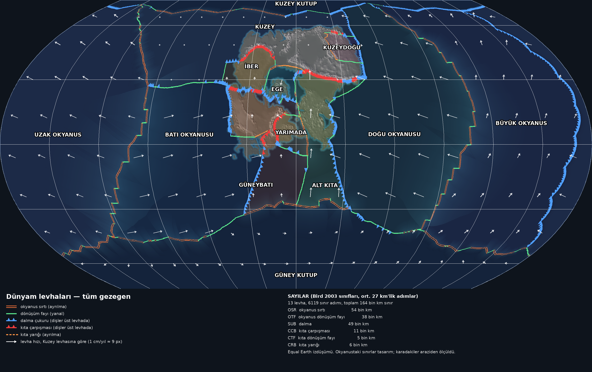
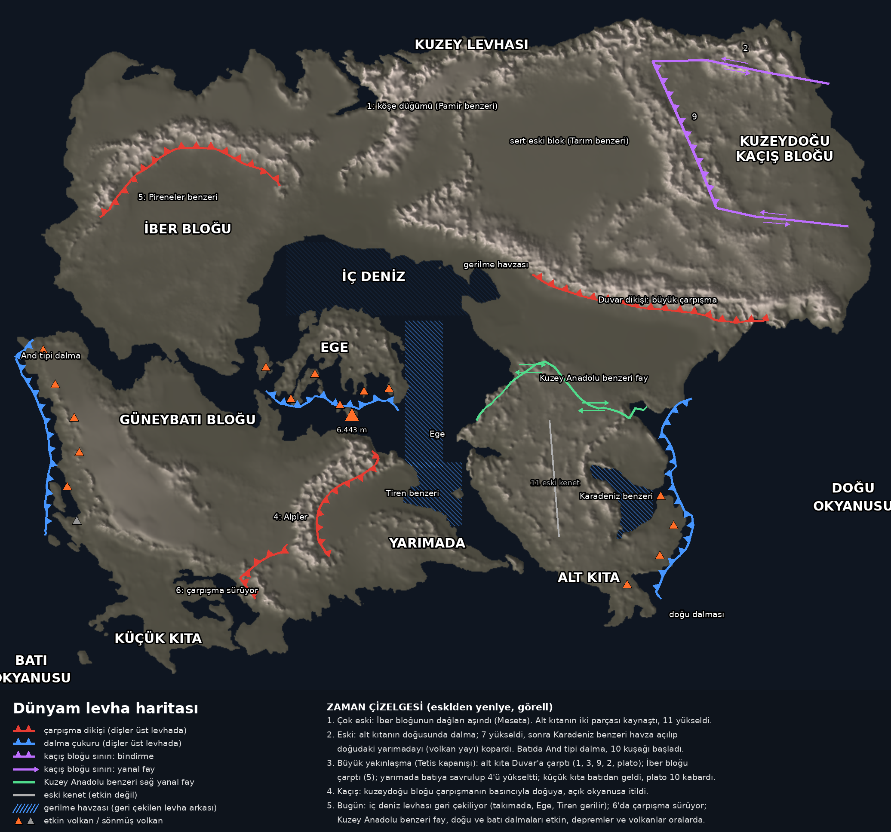

# Dünyam levha tektoniği — özet

Bu belge kendi başına okunacak biçimde yazıldı (başka bir kişi ya da yapay zekâ sohbeti için). Aynı bilgi makine için `ozet.json`'da. Kararların tarihçesi ve düzeltmeler `../TEKTONIK.md`'de. Belge `tektonik/ozet.py` ile modelden üretilir; elle düzenleme, betiği koş.

## 1. Kısaca

Dünyam kurgusal bir gezegen: yarıçap 6371 km, gün 15 saat, eksen eğikliği 28°. Tek bir kıtası var (yaklaşık 60°K ile 7°G, 47°B ile 43°D arası); gerisi okyanus. Kıtanın arazisini sahibi elle çizdi; levha hikâyesi bu araziden geriye doğru okundu: dağların yeri, yüksekliği, keskinliği ve gerçek Dünya'daki benzerleri. Hikâyenin omurgası: güneydeki bütün parçalar kuzeye yürüyüp kuzeydeki ana karaya çarpıyor (Afrika ve Hindistan'ın Avrasya'ya çarpması, yani Tetis'in kapanması gibi).

## 2. Okuma kuralları

- Koordinat: enlem kuzey +, boylam doğu + (−180..180), derece.
- Hız: cm/yıl, **Kuzey levhası sabit** kabul edilir; diğer hızlar ona göredir.
- Sınır türü elle yazılmadı: her ~27 km'lik sınır adımında iki levhanın göreli hızından hesaplandı (Bird 2003, PB2002 ölçütü): göreli hız sınıra 20°'den yakınsa **yanal**, değilse **yaklaşma** ya da **ayrılma**; iki yanı denizse okyanusal, değilse kıtasal.
- **Ölçülen** (güvenilir): karadaki sınırlar, dağların yeri ve yüksekliği. **Tasarım** (değiştirilebilir): okyanustaki sınırlar, okyanus levhalarının hızları, okyanus tabanı derinliği.

| kısaltma | anlamı |
|---|---|
| OSR | okyanus sırtı |
| OTF | okyanus dönüşüm fayı |
| OCB | okyanusal yakınlaşma |
| SUB | dalma |
| CRB | kıta yarığı |
| CTF | kıta dönüşüm fayı |
| CCB | kıta çarpışması |
| PAS | hareketsiz |

## 3. Levhalar

| levha | tür | alan (milyon km²) | kara payı | hareket (Kuzey'e göre) | komşular |
|---|---|---|---|---|---|
| Kuzey | kıta + okyanus | 55.8 | %28 | sabit (çerçeve) | Alt Kıta, Batı Okyanusu, Doğu Okyanusu, Ege, Kuzey Kutup, Kuzeydoğu, Uzak Okyanus, İber |
| Kuzeydoğu | kıta (küçük) | 3.4 | %77 | doğuya 1.5 cm/yıl | Doğu Okyanusu, Kuzey |
| İber | kıta (küçük) | 6.7 | %75 | kuzeye 0.5 cm/yıl | Batı Okyanusu, Ege, Güneybatı, Kuzey |
| Ege | kıta parçaları + deniz (mikro) | 4.5 | %32 | güneye 2.1 cm/yıl | Alt Kıta, Güneybatı, Kuzey, İber |
| Güneybatı | kıta + okyanus | 23.4 | %38 | kuzeye 1.0 cm/yıl | Alt Kıta, Batı Okyanusu, Ege, Güney Kutup, Yarımada, İber |
| Yarımada | kıta (mikro) | 4.6 | %49 | kuzeybatıya 2.2 cm/yıl | Alt Kıta, Güneybatı |
| Alt Kıta | kıta + okyanus | 20.6 | %41 | kuzeye 4.0 cm/yıl | Doğu Okyanusu, Ege, Güney Kutup, Güneybatı, Kuzey, Yarımada |
| Batı Okyanusu | okyanus (üstünde küçük kıta) | 77.1 | %2 | doğuya 4.6 cm/yıl | Güney Kutup, Güneybatı, Kuzey, Uzak Okyanus, İber |
| Doğu Okyanusu | okyanus | 97.5 | %0 | batıya 5.2 cm/yıl | Alt Kıta, Büyük Okyanus, Güney Kutup, Kuzey, Kuzey Kutup, Kuzeydoğu |
| Büyük Okyanus | okyanus | 110.1 | %0 | kuzeydoğuya 1.8 cm/yıl | Doğu Okyanusu, Güney Kutup, Kuzey Kutup, Uzak Okyanus |
| Uzak Okyanus | okyanus | 131.3 | %0 | batıya 3.2 cm/yıl | Batı Okyanusu, Büyük Okyanus, Güney Kutup, Kuzey, Kuzey Kutup |
| Kuzey Kutup | okyanus | 15.0 | %0 | doğuya 1.0 cm/yıl | Büyük Okyanus, Doğu Okyanusu, Kuzey, Uzak Okyanus |
| Güney Kutup | okyanus | 110.4 | %0 | doğuya 1.0 cm/yıl | Alt Kıta, Batı Okyanusu, Büyük Okyanus, Doğu Okyanusu, Güneybatı, Uzak Okyanus |

## 4. Sınırlar

Uzunluğa göre sıralı; 150 km'den kısa parçalar tabloda yok (hepsi `ozet.json`'da). 'yaklaşma' artıysa levhalar birbirine yaklaşıyor, eksiyse ayrılıyor. Aynı sınır birden çok levha çiftine değiyorsa her çift ayrı satır. [tasarım] işaretli sınırlar okyanusta, araziyle sınanmadı.

| sınır | arasındaki levhalar | baskın tür | uzunluk (km) | yaklaşma (cm/yıl) | üst levha | anlamı |
|---|---|---|---|---|---|---|
| Doğu sırtı | Büyük Okyanus / Doğu Okyanusu | okyanus sırtı (%76) | 16927 | -3.3 | — | [tasarım] Büyük Okyanus ile Doğu Okyanusu birbirinden ayrılıyor (3.3 cm/yıl). |
| Uzak okyanus çukuru | Büyük Okyanus / Uzak Okyanus | dalma (%100) | 14776 | +3.2 | Büyük Okyanus | [tasarım] Uzak Okyanus, Büyük Okyanus levhasının altına dalıyor (3.2 cm/yıl). |
| Batı sırtı | Batı Okyanusu / Uzak Okyanus | okyanus sırtı (%78) | 10900 | -5.2 | — | [tasarım] Batı Okyanusu ile Uzak Okyanus birbirinden ayrılıyor (5.2 cm/yıl). |
| Doğu dalması | Alt Kıta / Doğu Okyanusu | dalma (%65) | 8969 | +3.5 | Alt Kıta | Doğu Okyanusu, Alt Kıta levhasının altına dalıyor (3.5 cm/yıl). Doğu Okyanusu batıya, Alt Kıta'nın altına dalıyor; doğudaki yarımada volkan yayı. |
| Kuzey kutup sınırı | Kuzey / Kuzey Kutup | okyanus sırtı (%56) | 8247 | -0.3 | — | [tasarım] Kuzey ile Kuzey Kutup birbirinden ayrılıyor (0.3 cm/yıl). |
| Güney sırtı | Batı Okyanusu / Güney Kutup | okyanus dönüşüm fayı (%58) | 8137 | -1.1 | — | [tasarım] Batı Okyanusu ile Güney Kutup yan yana kayıyor. |
| Güneydoğu sırtı | Büyük Okyanus / Güney Kutup | okyanus sırtı (%79) | 6965 | -0.8 | — | [tasarım] Büyük Okyanus ile Güney Kutup birbirinden ayrılıyor (0.8 cm/yıl). |
| Batı sırtı | Kuzey / Uzak Okyanus | okyanus sırtı (%72) | 6754 | -0.8 | — | [tasarım] Kuzey ile Uzak Okyanus birbirinden ayrılıyor (0.8 cm/yıl). |
| 6 çarpışması ve güney uzantısı | Batı Okyanusu / Güneybatı | dalma (%60) | 5903 | +2.8 | Güneybatı | Batı Okyanusu, Güneybatı levhasının altına dalıyor (2.8 cm/yıl). Batı Okyanusu'nun taşıdığı küçük kıta Güneybatı bloğuna çarpıyor (6, etkin); güneyinde okyanusal dalma. |
| Güney sırtı | Doğu Okyanusu / Güney Kutup | okyanus dönüşüm fayı (%66) | 4928 | +0.5 | — | [tasarım] Doğu Okyanusu ile Güney Kutup yan yana kayıyor. |
| 27°K dönüşüm fayı | Batı Okyanusu / Kuzey | okyanus dönüşüm fayı (%80) | 4686 | +0.8 | — | [tasarım] Batı Okyanusu ile Kuzey yan yana kayıyor. |
| Batı dalması (And tipi) | Batı Okyanusu / Güneybatı | dalma (%63) | 4489 | +2.5 | Güneybatı | Batı Okyanusu, Güneybatı levhasının altına dalıyor (2.5 cm/yıl). Batı Okyanusu, Güneybatı bloğunun altına dalıyor (And tipi); kıyıda volkanlar. |
| Uzak güney sırtı | Güney Kutup / Uzak Okyanus | okyanus sırtı (%88) | 4441 | -1.5 | — | [tasarım] Güney Kutup ile Uzak Okyanus birbirinden ayrılıyor (1.5 cm/yıl). |
| Güney sırtı | Alt Kıta / Güney Kutup | okyanus sırtı (%89) | 3882 | -3.1 | — | [tasarım] Alt Kıta ile Güney Kutup birbirinden ayrılıyor (3.1 cm/yıl). |
| 5 dikişi (Pireneler benzeri) | Kuzey / İber | kıta çarpışması (%70) | 3796 | +0.4 | Kuzey | İber, Kuzey levhasına çarpıyor, altına giriyor (0.4 cm/yıl). İber bloğu kuzeye, Kuzey levhasına çarpmış; 5 dağları (Pireneler benzeri). |
| Güney sırtı | Güney Kutup / Güneybatı | okyanus sırtı (%96) | 3628 | -1.2 | — | [tasarım] Güney Kutup ile Güneybatı birbirinden ayrılıyor (1.2 cm/yıl). |
| Ege çukuru | Ege / Güneybatı | dalma (%89) | 3238 | +2.1 | Ege | Güneybatı, Ege levhasının altına dalıyor (2.1 cm/yıl). İç deniz tabanı (Güneybatı levhası) kuzeye, Ege'nin altına dalıyor; adaların güneyinde volkan yayı. |
| Kuzey doğu kıyısı | Doğu Okyanusu / Kuzey | dalma (%100) | 3060 | +3.0 | Kuzey | Doğu Okyanusu, Kuzey levhasının altına dalıyor (3.0 cm/yıl). Doğu Okyanusu, Kuzey ve Kuzeydoğu levhalarının altına dalıyor. |
| Kuzey kutup sınırı | Büyük Okyanus / Kuzey Kutup | dalma (%84) | 2999 | +1.6 | Kuzey Kutup | [tasarım] Büyük Okyanus, Kuzey Kutup levhasının altına dalıyor (1.6 cm/yıl). |
| Güneybatı-Alt kıta güney | Alt Kıta / Güneybatı | okyanus dönüşüm fayı (%95) | 2650 | +0.3 | — | Alt Kıta ile Güneybatı yan yana kayıyor. Güneye uzanan yanal fay: iki levha aynı yönde farklı hızla kuzeye gidiyor. |
| Yarımada güneyi | Güneybatı / Yarımada | okyanus dönüşüm fayı (%58) | 2632 | +0.7 | — | Güneybatı ile Yarımada yan yana kayıyor. Yarımadanın güneyi, çoğunlukla yanal. |
| Duvar dikişi | Alt Kıta / Kuzey | kıta çarpışması (%90) | 2597 | +3.8 | Kuzey | Alt Kıta, Kuzey levhasına çarpıyor, altına giriyor (3.8 cm/yıl). Büyük çarpışma cephesi: Alt Kıta kuzeye, Kuzey levhasının altına giriyor (Himalaya benzeri). Duvar dağları (3) bunun ürünü. |
| Kuzey kutup sınırı | Kuzey Kutup / Uzak Okyanus | dalma (%94) | 2456 | +0.7 | Kuzey Kutup | [tasarım] Uzak Okyanus, Kuzey Kutup levhasının altına dalıyor (0.7 cm/yıl). |
| İber-Güneybatı boğazı | Güneybatı / İber | kıta çarpışması (%50) | 2381 | +0.5 | Güneybatı | İber, Güneybatı levhasına çarpıyor, altına giriyor (0.5 cm/yıl). İber ile Güneybatı arası boğaz; yavaş yakınlaşma (Cebelitarık benzeri). |
| Ege doğu sınırı | Alt Kıta / Ege | okyanus dönüşüm fayı (%54) | 2051 | +0.9 | — | Alt Kıta ile Ege yan yana kayıyor. Ege ile Alt Kıta arası, çoğunlukla yanal (Alt Kıta kuzeye, Ege güneye). |
| Yarımada boğazı | Alt Kıta / Yarımada | okyanus sırtı (%63) | 2044 | -2.8 | — | Alt Kıta ile Yarımada birbirinden ayrılıyor (2.8 cm/yıl). Yarımada ile Alt Kıta arası boğaz: açılan yarık (yarımada Alt Kıta'dan kopuyor). |
| 9 (kaçış bloğu batısı) | Kuzey / Kuzeydoğu | kıta yarığı (%100) | 1943 | -1.3 | — | Kuzey ile Kuzeydoğu birbirinden ayrılıyor (1.3 cm/yıl). Kuzeydoğu kaçış bloğunun batı sınırı (9): blok doğuya giderken açılan Baykal tipi yarık. |
| Ege yay ardı sınırı | Ege / Kuzey | kıta yarığı (%89) | 1879 | -2.0 | — | Ege ile Kuzey birbirinden ayrılıyor (2.0 cm/yıl). Ege güneye çekilirken arkasında açılan yay ardı yarığı (iç denizin kuzeyi). |
| Kuzey doğu kıyısı | Doğu Okyanusu / Kuzeydoğu | dalma (%100) | 1660 | +5.1 | Kuzeydoğu | Doğu Okyanusu, Kuzeydoğu levhasının altına dalıyor (5.1 cm/yıl). Doğu Okyanusu, Kuzey ve Kuzeydoğu levhalarının altına dalıyor. |
| kaçış bloğu güneyi | Kuzey / Kuzeydoğu | kıta dönüşüm fayı (%78) | 1616 | -0.2 | — | Kuzey ile Kuzeydoğu yan yana kayıyor. Kaçış bloğunun güney sınırı (Duvar'ın kuzey eteği), yanal. |
| Ege batı sınırı | Ege / İber | okyanus dönüşüm fayı (%53) | 1584 | -0.7 | — | Ege ile İber yan yana kayıyor. Ege ile İber arası, çoğunlukla yanal. |
| 4 dikişi (Alpler) | Güneybatı / Yarımada | kıta çarpışması (%100) | 1542 | +1.5 | Yarımada | Güneybatı, Yarımada levhasına çarpıyor, altına giriyor (1.5 cm/yıl). Yarımada batıya, Güneybatı bloğuna çarpıyor; 4 dağları (Alpler benzeri). Yarımada üst levha. |
| 2 (kaçış bloğu kuzeyi) | Kuzey / Kuzeydoğu | kıta dönüşüm fayı (%42) | 1524 | +0.3 | — | Kuzey ile Kuzeydoğu yan yana kayıyor. Kaçış bloğunun kuzey sınırı (2 dağları), çoğunlukla yanal. |
| Kuzey kutup sınırı | Doğu Okyanusu / Kuzey Kutup | dalma (%90) | 1295 | +2.5 | Kuzey Kutup | [tasarım] Doğu Okyanusu, Kuzey Kutup levhasının altına dalıyor (2.5 cm/yıl). |
| İber batı kıyısı | Kuzey / İber | okyanus dönüşüm fayı (%100) | 1169 | +0.1 | — | Kuzey ile İber yan yana kayıyor. İber bloğunun batı kıyısı, yanal. |
| Duvar doğu ucu | Alt Kıta / Kuzey | dalma (%68) | 1166 | +3.2 | Kuzey | Alt Kıta, Kuzey levhasının altına dalıyor (3.2 cm/yıl). Duvar'ın doğu ucu, kıyıya kadar. |
| Yarımada kuzeyi (Tiren) | Güneybatı / Yarımada | okyanus dönüşüm fayı (%51) | 1098 | -0.3 | — | Güneybatı ile Yarımada yan yana kayıyor. Yarımadanın kuzeyi, yanal; kuzeyindeki körfez Tiren benzeri gerilme havzası. |
| Uzak güney sırtı | Güney Kutup / Uzak Okyanus | okyanus dönüşüm fayı (%88) | 879 | -0.1 | — | [tasarım] Güney Kutup ile Uzak Okyanus yan yana kayıyor. |
| Güneybatı-Alt kıta | Alt Kıta / Güneybatı | kıta dönüşüm fayı (%54) | 732 | -0.8 | — | Alt Kıta ile Güneybatı yan yana kayıyor. Güneybatı ile Alt Kıta arası, yanal. |
| İber-Güneybatı boğazı | Batı Okyanusu / İber | dalma (%71) | 378 | +1.6 | İber | Batı Okyanusu, İber levhasının altına dalıyor (1.6 cm/yıl). İber ile Güneybatı arası boğaz; yavaş yakınlaşma (Cebelitarık benzeri). |
| Batı dalması (And tipi) | Batı Okyanusu / İber | okyanus dönüşüm fayı (%100) | 207 | +0.9 | — | Batı Okyanusu ile İber yan yana kayıyor. Batı Okyanusu, Güneybatı bloğunun altına dalıyor (And tipi); kıyıda volkanlar. |
| Ege doğu sınırı | Alt Kıta / Kuzey | kıta çarpışması (%100) | 191 | +3.4 | Kuzey | Alt Kıta, Kuzey levhasına çarpıyor, altına giriyor (3.4 cm/yıl). Ege ile Alt Kıta arası, çoğunlukla yanal (Alt Kıta kuzeye, Ege güneye). |
| Batı dalması (And tipi) | Güneybatı / İber | dalma (%67) | 169 | +0.5 | Güneybatı | İber, Güneybatı levhasının altına dalıyor (0.5 cm/yıl). Batı Okyanusu, Güneybatı bloğunun altına dalıyor (And tipi); kıyıda volkanlar. |
| Doğu sırtı | Doğu Okyanusu / Güney Kutup | okyanus dönüşüm fayı (%100) | 155 | -0.1 | — | [tasarım] Doğu Okyanusu ile Güney Kutup yan yana kayıyor. |
| Güneydoğu sırtı | Doğu Okyanusu / Güney Kutup | okyanus dönüşüm fayı (%100) | 150 | +1.0 | — | [tasarım] Doğu Okyanusu ile Güney Kutup yan yana kayıyor. |

## 5. Dağlar ve yer şekilleri (kıta)

| no | ad | yer (enlem, boylam) | yükseklik (m) | gerçek benzeri | kökeni |
|---|---|---|---|---|---|
| 1 | Kuzey batı kolu | 51.8, -2.2 | 7000 | Pamir | Dünyanın en yüksek noktası. Çarpan Alt Kıta'nın kuzeybatı köşesinde sıkışan düğüm. |
| 2 | Kuzeydoğu kıyı sırası | 55.2, 30.2 | 6760 | Altay | Kaçış bloğunun kuzey sınırı; çarpışmanın uzak etkisi. |
| 3 | Duvar | 39.0, 20.0 | 6729 | Himalaya | ~11.400 km'lik çarpışma kuşağı; güneyinde önülke ovası (Ganj benzeri). |
| 9 | Plato doğusu sırası | 47.3, 26.5 | 4683 | Tanrı Dağları + Baykal | Önce sıkışmayla yükseldi; bugün doğu eteğinde yarık açılıyor. |
| plato | Plato çanağı | 46.4, 10.1 | 880 | Tarım / Moğol platosu | 3,8 milyon km², kıvrılmamış sert eski blok; bozkır. |
| 5 | İber kuzey sırası | 46.5, -26.3 | 6563 | Pireneler | İber bloğunun kuzeye çarpmasıyla. |
| meseta | İber yaylası | 43.0, -22.0 | 535 | Meseta (İspanya) | Çok eski dağların aşınmış kökleri; düz yayla. |
| 4 | Yay biçimli sıra | 10.9, -13.9 | 6706 | Alpler | Yarımadanın batıya çarpmasıyla; iç bükeyinde Po benzeri ova (8,6°K −10,3°). |
| yarımada | Yarımada omurgası | 6.8, -4.4 | 5143 | Apeninler / İtalya | Alt Kıta'nın kopan çıkıntısı. |
| 10 | Güneybatı platosu | 12.3, -32.1 | 4621 | Altiplano / And | Küçük kıtanın altına sokulmasıyla kalınlaşan kabuk; ort. 2.278 m. |
| 6 | Güney çarpışma noktası | 1.5, -19.2 | 5924 | St. Elias (Alaska) | Küçük kıtanın hâlâ çarptığı yer; en keskin kesim. |
| küçük kıta | Güneybatı düz yarımada | -2.0, -30.0 | 712 | Zelandia | Batı Okyanusu'nun taşıdığı hafif kıta parçası; 1,13 milyon km², düz. |
| 7 | Alt Kıta doğu kıyısı sırası | 14.0, 14.6 | 5892 | Pontidler | Doğudaki dalmanın eski kenarı; doğusundaki körfez Karadeniz benzeri. |
| 8 | Alt Kıta batı kıyısı sıraları | 15.0, 4.0 | 5594 | Batı Anadolu / Ege | Kısa, dik parçalar; aralarında denize açılan çöküntü vadileri (gerilme). |
| 11 | Alt Kıta orta kuşağı | 12.3, 10.5 | 3488 | Kırşehir / İzmir-Ankara kenedi | En eski kuşak: Alt Kıta'nın iki parçasının dikişi; aşınmış. |
| takımada | İç deniz takımadası | 25.0, -12.0 | 6443 | Yunanistan / Ege adaları | Güneye çekilip gerilen kabuk; en yüksek nokta büyük bir volkan. |

Levha içi yapılar: Alt Kıta'nın yaylasıyla kuzeyindeki ova arasında, kabaca doğu-batı uzanan **Kuzey Anadolu benzeri sağ yanal fay**. Gerilme havzaları: iç denizin kuzeyi (yay ardı), takımada ile Alt Kıta arası (**Ege**), yarımadanın kuzeyindeki körfez (**Tiren benzeri**), Alt Kıta'nın doğusundaki kapalı körfez (**Karadeniz benzeri**).

## 6. Tarih (eskiden yeniye, göreli)

1. **çok eski**: İber bloğunun eski dağları aşındı (Meseta). Alt Kıta'nın iki parçası kaynaştı, 11 yükseldi.
2. **eski**: Alt Kıta'nın doğusunda dalma; 7 yükseldi, sonra Karadeniz benzeri körfez açılıp doğudaki yarımadayı kopardı. Batıda And tipi dalma, 10 kuşağı başladı.
3. **büyük yakınlaşma**: Güneydeki bütün parçalar kuzeye yürüdü (Tetis kapanışı benzeri): Alt Kıta Duvar'a çarptı (1, 2, 3, plato); İber bloğu çarptı (5); yarımada batıya savrulup 4'ü yükseltti; küçük kıta batıdan geldi, plato 10 kabardı.
4. **kaçış**: Kuzeydoğu bloğu çarpışmanın basıncıyla doğuya itildi; arkasında (9) Baykal tipi yarık açıldı.
5. **bugün**: İç deniz levhası geri çekiliyor (takımada, Ege, Tiren gerilir); 6'da çarpışma sürüyor; Kuzey Anadolu benzeri fay, doğu ve batı dalmaları etkin.

Rakam (milyon yıl) verilmedi: arazi yalnız göreli sırayı söyler.

## 7. Açık kararlar

- Okyanus levhalarının sayısı, sırtların yeri ve hızlar tasarım; okyanus tabanı verisi yok.
- Buzul çağı geçmişi (Alp tipi buzul gölleri için) henüz karar verilmedi.
- Göller ve nehirler bu modelden sonra gelecek (yarık gölleri: 9, Alt Kıta'nın kapalı havzaları).

## 8. Dosyalar

- `levha_dunya.png`: tüm gezegen, Equal Earth
- `levha_kure.png`: iki küre görünümü
- `levha_haritasi.png`: kıta ayrıntısı, dağ numaraları, zaman çizelgesi
- `sinirlar.geojson`: her sınır adımı bir LineString; özellikler: sinir, sol, sag, sinif, ust, yaklasma, yanal, km
- `levha_kimlik.png`: 0,1° ızgara (3600×1800, satır 0 = 90°K), değer = levha kimliği (levhalar.json 'kimlik')
- `levhalar.json`: levha alanları, Euler kutupları
- `TEKTONIK.md`: kararların tarihçesi (düzeltmeler dahil)
